# Architecture

This file answers two questions: **can the results be trusted** (see [Guarantees](#guarantees)), and **what must I know to extend HARBOR** (see [Extending HARBOR](#extending-harbor)). The source is the full detail.

## Pipeline shape

```mermaid
flowchart LR
    yaml["experiments/*.yaml"]
    runner["src/experiments<br/>grid runner"]
    ext["src/extraction<br/>ingestion, LLM sentiment,<br/>temporal enrichment"]
    train["src/training<br/>walk-forward backtest"]
    evaluate["src/evaluation<br/>metrics + persistence"]
    server["src/server.py<br/>FastAPI"]
    dashboard["frontend/<br/>React dashboard"]

    config[/"Config"/]
    pipelineinput[/"PipelineInput"/]
    pipelineoutput[/"PipelineOutput"/]
    pipelineevaluation[/"PipelineEvaluation"/]

    rawdata[("data/stock_data<br/>data/articles")]
    checkpoints[("data/system/<br/>parsing_checkpoints")]
    fitcache[("data/training_cache")]
    outputs[("data/system/<br/>execution_output")]

    yaml --> runner
    runner -->|one per grid cell| config
    config -->|once per extraction config| ext
    config --> train
    ext --> pipelineinput
    pipelineinput --> train
    train --> pipelineoutput
    pipelineoutput --> evaluate
    evaluate --> pipelineevaluation
    pipelineevaluation -->|persisted alongside PipelineOutput| outputs
    outputs --> server
    server --> dashboard

    rawdata --> ext
    checkpoints <-->|cached LLM scores| ext
    fitcache <-->|cached fits| train

    classDef runnerModule fill:#f1f5f9,stroke:#475569,color:#111827
    classDef runnerContract fill:#cbd5e1,stroke:#334155,stroke-width:2px,color:#111827
    classDef extractionModule fill:#f0fdf4,stroke:#15803d,color:#111827
    classDef extractionContract fill:#bbf7d0,stroke:#15803d,stroke-width:2px,color:#111827
    classDef trainingModule fill:#fffbeb,stroke:#b45309,color:#111827
    classDef trainingContract fill:#fde68a,stroke:#b45309,stroke-width:2px,color:#111827
    classDef evaluationModule fill:#f5f3ff,stroke:#6d28d9,color:#111827
    classDef evaluationContract fill:#ddd6fe,stroke:#6d28d9,stroke-width:2px,color:#111827

    class runner runnerModule
    class config runnerContract
    class ext extractionModule
    class pipelineinput extractionContract
    class train trainingModule
    class pipelineoutput trainingContract
    class evaluate evaluationModule
    class pipelineevaluation evaluationContract
```

The parallelograms are the typed contracts (Pydantic models in `src/models/`), the only things that cross a module boundary; each shares the colour of the module that produces it. The runner turns each grid cell of the YAML into a `Config`, and extraction runs once per unique extraction configuration, shared by every run that needs it. Within a run, evaluation receives only the `PipelineOutput` that training hands over and never touches training state; the leakage guarantee below rests on that boundary.

Parallelism happens at three levels, none of which crosses a contract: the runner executes runs in parallel (a process pool), training fits a run's stocks in parallel (a second process pool, for models where fitting is costly), and extraction sends its LLM scoring requests concurrently in batches.

| Module             | Responsibility                                                                                                                                                                                                  |
| ------------------ | --------------------------------------------------------------------------------------------------------------------------------------------------------------------------------------------------------------- |
| `src/extraction/`  | polars-based ingestion, LLM sentiment scoring (async, batched, checkpointed), temporal feature enrichment                                                                                                       |
| `src/training/`    | walk-forward backtesting, per-stock parallel training (`ProcessPoolExecutor`), disk-backed fit cache, retraining cadence                                                                                        |
| `src/evaluation/`  | metrics (see [METRICS.md](METRICS.md)) and persistence: per-run JSON, the run index, frontend-optimised run detail                                                                                              |
| `src/experiments/` | YAML grid runner with parallel execution, extraction cache, reindex CLI                                                                                                                                         |
| `src/models/`      | Pydantic data contracts exchanged at module boundaries                                                                                                                                                          |
| `src/server.py`    | FastAPI server: `POST /api/run_details` (batch read with optional field slicing), `DELETE /api/runs` (bulk delete), and a static mount at `/` serving `runs_index.json`, `run_detail.json` and `.stock_prices/` |
| `src/paths.py`     | every filesystem path; nothing else hardcodes one                                                                                                                                                               |
| `frontend/`        | React SPA (Bun, Vite, Tailwind, plotly.js, shadcn/ui, TanStack Query), talking to the FastAPI server on `http://localhost:3001` via CORS                                                                        |

## Guarantees

What the pipeline enforces, so a reported number means what it says. Violations raise; nothing is repaired silently.

- **No look-ahead.** Extraction output is split into physically separate training and test structures. During backtesting a model receives data day by day via `update()`, never in batches. Evaluation consumes only `PipelineOutput`, behind the module boundary, so it cannot reach into training state.
- **News never travels backwards in time.** Articles published on non-trading days shift to the next trading day, never the previous one (`_align_semantic_to_trading_days()`).
- **Complete inputs.** After enrichment every trading day carries semantic data: days without news get synthetic scores with decayed EMAs. A missing day raises instead of being zero-filled (`enrich_temporal_features()`).
- **Every seed is run.** Neural models run once per seed listed in the experiment; deterministic models run once, since repeating them changes nothing.
- **Skipped cells are announced.** ARIMA with `"auto"` retraining cadence at a 1-day horizon fails deterministically (LU decomposition under daily re-estimation), so the runner skips those cells up front with a warning rather than dropping them unnoticed. An explicit `retraining_cadence_days: 1` forces them.

## Extending HARBOR

**Adding a configuration knob.** Add the field to `Config` (`src/models/config.py`), document it in `experiments/00_template.yaml`, and make sure every model that is affected emits it in its `training_signature`. The fit cache is keyed by that signature: a knob missing from it lets the cache silently serve fits that were trained without it. Every knob is emitted always, including at its default, so new knobs can never collide with existing cache entries.

**Adding a model.**

1. Implement the `PredictionModel` protocol (`src/training/protocols.py`): `fit`, `predict`, `update`, `refit`, plus
   - `training_signature`, encoding every hyperparameter that affects training;
   - `uses_semantic`, whether it consumes the sentiment features;
   - `parallelizable`, `True` when fitting is costly enough to justify a process pool, `False` for near-instant baselines where pool overhead dominates.
2. Register it in `MODEL_REGISTRY` (`src/experiments/runner.py`) and list it in `experiments/00_template.yaml`.
3. **Neural models** subclass `TorchStrategy` (`src/training/strategies/base.py`) and must also be added to `_TORCH_MODELS` in the runner. That set gives a model the shared hyperparameters and one run per seed; a neural model outside it runs single-seed.

**Adding stocks.** FNSPID stitched two scrapes together around mid-2020. Stocks that split between then and the dataset's assembly show a fake split-sized price jump at the scrape join (not at the real split date), in both `close` and `adj close`. Check a new ticker's prices around mid-2020 before adding it; affected stocks need prices from another source.

## Reference

### Data layout

Machine-generated artifacts live under `data/`, never in `experiments/` (hand-written YAML only).

| Path                               | Contents                                                                                                                                                                                                                                              |
| ---------------------------------- | ----------------------------------------------------------------------------------------------------------------------------------------------------------------------------------------------------------------------------------------------------- |
| `data/stock_data/{STOCK}.csv`      | daily OHLCV for the stock universe (FNSPID)                                                                                                                                                                                                           |
| `data/articles/{STOCK}.csv`        | per-stock news (FNSPID)                                                                                                                                                                                                                               |
| `data/system/execution_output/`    | per-run folders `{model_type}/{date}_{name}_{counter}/` with `pipeline_output.json` (canonical record, omitted in this release), `pipeline_input.json`, `run_detail.json`, `metrics.md`; plus `runs_index.json`, `.stock_prices/` and `.input_cache/` |
| `data/system/parsing_checkpoints/` | cached LLM sentiment scores, `checkpoint_{model}_headlines_{tag}.json` or `..._articles_{tag}.json` depending on extraction mode                                                                                                                      |
| `data/training_cache/`             | disk-backed fit cache, created on first run                                                                                                                                                                                                           |

### Data contracts (`src/models/`)

- `input.py`: `NumericData`, `SemanticScore`, `SemanticData`, `StockDataPairings`, `PipelineInput`, plus the sector map.
- `output.py`: `PredictionRecord`, `TradeRecord`, `PortfolioSnapshot`, `PipelineOutput`.
- `config.py`: `Config`. Key fields:
  - `sequence_length` (default 60), `rebalance_horizon_days`, `top_k`;
  - `feature_set` (`full` | `numeric` | `close_only`, the neural input width);
  - `headline_only`, `sentiment_ema_spans`;
  - `min_predicted_return`, `conviction_mode` (`fixed` | `volatility_scaled`; the latter only acts when `min_predicted_return > 0`);
  - `retraining_cadence_days`: `None` (frozen), an integer number of test days, or `"auto"` (refit every rebalance horizon).
- `evaluation.py`: `PipelineEvaluation`, the metric set described in [METRICS.md](METRICS.md).
